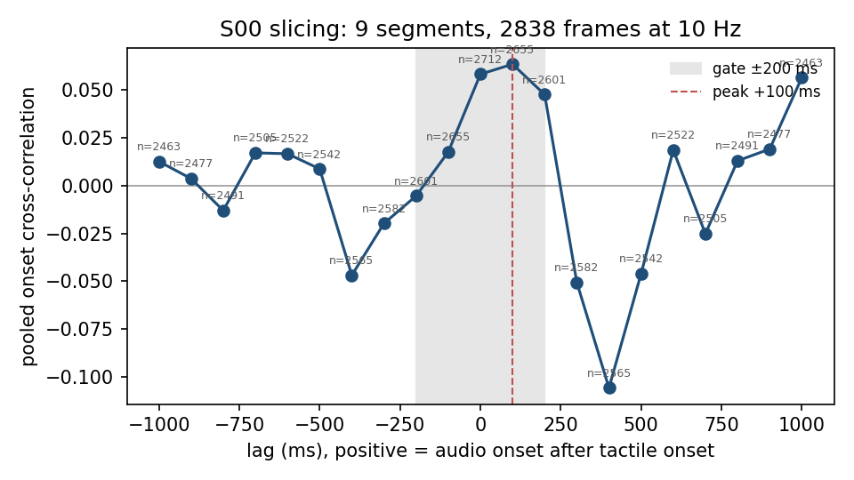
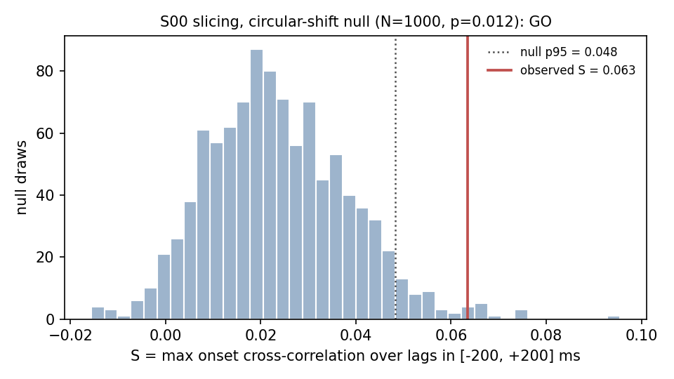

# ActionSense S00 pilot, run 2: go/no-go gate report

> **Null test rule** (PI decision 2026-10-29, fixed before any computation;
> script `scripts/pilot_actionsense_null.py` committed in `fcd957e` before it
> was run; results in "Null test (2026-10-29)" at the end):
>
> - Statistic S = the maximum cross-correlation over lags in [−200, +200] ms
>   between tactile.sum(1) onsets and audio-energy onsets on the slicing
>   frames, computed exactly as in scripts/pilot_actionsense_xcorr.py (same
>   onset definition, same lag grid, same frame selection by segment).
> - Null: for each of N = 1000 draws (seed 0, numpy default_rng), circularly
>   shift the audio-onset series independently within each labelled segment
>   by a uniform random offset of at least 2 s and at most (segment length −
>   2 s); segments shorter than 4 s are left unshifted and counted. Compute S
>   on each draw.
> - Decision: GO if S_observed > the 95th percentile of the null; otherwise
>   NO-GO. Report also the empirical p-value (1 + #null ≥ S_obs)/(N + 1), the
>   null mean and 95th percentile, and the number of unshifted short segments.

Date: 2026-10-29. Spec: `docs/superpowers/specs/2026-10-28-actionsense-world-design.md`,
section 7 (check 2 as amended on 2026-10-29). Issues: #45, #52. Code: `main` at
`b0814ab` (#51: piecewise least-squares audio clock fit replaces the 20 ms
drift test). Same machine (macM1, macOS 27.0.1), nerve-wml v1.8.1, ffmpeg
9.0.2, same raw files (sizes and sha256 in `actionsense-s00.md`), same driver
`scripts/pilot_actionsense.sh` and helper `scripts/pilot_actionsense_xcorr.py`,
same thresholds. Run 1 report: `actionsense-s00.md` (unchanged).

## Verdict

| check | run 1 (`06525dd`) | run 2 (`b0814ab`) | key number, run 2 |
|---|---|---|---|
| 1. no abort, equal lengths | PASS | PASS | 12 597 rows in all tensors |
| 2. clock agreement (amended) | PASS (caveat) | PASS | labelled span inside video and audio spans; 0 backwards steps; offsets below |
| 3. tactile/audio onset xcorr | formal PASS, not evidential | PASS, weak | peak +100 ms (0.063, 2655 pairs); 0 ms 0.058 (2712 pairs) |
| 4. extraction determinism | PASS | PASS | 8/8 sha256 identical |
| 5. smoke cell determinism | PASS | PASS | 4/4 sha256 identical |

All five checks pass with the unchanged thresholds. Check 3 is now well
sampled, but its peak is small and only marginally above the largest value
outside the gate (0.063 vs 0.056 at +1000 ms), and the largest |value| of the
curve is a trough of -0.106 at +400 ms; see check 3. The go/no-go for Task 6
is the PI's decision; this run does not start Task 6.

## Extraction

Two runs of `extract_actionsense.py --subjects S00` under `nice -n 10`:
373 s and 372 s wall time (same as run 1).

| counter | run 1 | run 2 | run 2 share of 13 192 |
|---|---|---|---|
| `frames_total` | 13 192 | 13 192 | 100 % |
| `drop:tactile` | 448 | 448 | 3.4 % |
| `drop:force` / `drop:gravity` / `drop:vision` | 0 / 0 / 0 | 0 / 0 / 0 | 0 % |
| `drop:audio` (all `gap`, 0 `outside_span`) | 5 579 | **147** | **1.1 %** (was 42.3 %) |
| `frames_kept` | 7 165 | **12 597** | 95.5 % |

New audio counters: `audio_breakpoints` 29 (both microphone files),
`audio_breakpoint_drop` 154 (frames within 1 s of a breakpoint, counted
before the tactile drop; the 147 audio drops after it are consistent with
all being breakpoint drops, not verified frame by frame), `audio_segment_bad_clock_fit` 0 (counter
absent from MANIFEST.md: no segment rejected), no `audio_file_inconsistent`.
`bad` 1, `unclosed` 0; unmapped pairs as in run 1.

Class frequencies (rows / share): cutting 5624 / 0.4465, spreading and jars
1051 / 0.0834, cleaning 1155 / 0.0917, pouring and tableware 4767 / 0.3784.
**Majority-class baseline: 0.4465** (run 1: 0.4452).

## Audio clock fit (MANIFEST.md)

Times are relative to the first labelled segment start of `18-11-37`; the
labelled span is 0.0 .. 2967.8 s.

### `2022-06-07_17-13-41` microphone (covers no labelled frame)

6 segments, 5 breakpoints: -3399.9 s (+0.099 s), -2449.3 s (+0.094 s),
-2320.3 s (+0.094 s), -2273.4 s (+0.094 s), -1871.3 s (+0.092 s).
All 6 segments accepted: rate 47999.52 .. 47999.55 Hz (|dev| 9.4e-06 ..
9.9e-06); |residual| median 0.0142 .. 0.0143 s, p99 0.0283 .. 0.0284 s, max
0.0284 .. 0.0303 s.

### `2022-06-07_18-11-04` microphone (the one in use)

25 segments, 24 breakpoints (time, step):

| breakpoint (s) | step (s) | | breakpoint (s) | step (s) |
|---|---|---|---|---|
| -247.8 | +0.092 | | 1670.8 | +0.094 |
| -105.6 | +0.098 | | 1947.3 | +0.097 |
| 137.4 | +0.093 | | 2131.7 | +0.092 |
| 305.0 | +0.093 | | 2281.1 | +0.094 |
| 480.9 | +0.094 | | 2425.0 | +0.094 |
| 809.4 | +0.091 | | 2885.6 | +0.094 |
| 883.2 | +0.095 | | 3033.9 | +0.094 |
| 950.2 | +0.098 | | 3118.4 | +0.094 |
| 1050.8 | +0.098 | | 3162.1 | +0.098 |
| 1067.5 | +0.099 | | 3289.2 | +0.094 |
| 1293.7 | +0.093 | | 3330.0 | +0.098 |
| 1545.1 | +0.096 | | 3340.3 | +0.097 |

16 of them fall inside the labelled span. Per segment, all 25 accepted:

| segment | chunks | span (s) | rate (Hz) | |dev| | |res| median / p99 / max (s) |
|---|---|---|---|---|---|
| 1 | 0..1653 | -318.5 .. -247.9 | 47999.584 | 8.67e-06 | 0.0143 / 0.0284 / 0.0284 |
| 2 | 1653..4985 | -247.8 .. -105.7 | 47999.569 | 8.98e-06 | 0.0143 / 0.0283 / 0.0284 |
| 3 | 4985..10678 | -105.6 .. 137.3 | 47999.563 | 9.10e-06 | 0.0143 / 0.0283 / 0.0289 |
| 4 | 10678..14604 | 137.4 .. 304.9 | 47999.557 | 9.24e-06 | 0.0143 / 0.0283 / 0.0292 |
| 5 | 14604..18725 | 305.0 .. 480.8 | 47999.545 | 9.48e-06 | 0.0143 / 0.0283 / 0.0288 |
| 6 | 18725..26422 | 480.9 .. 809.4 | 47999.544 | 9.51e-06 | 0.0143 / 0.0283 / 0.0306 |
| 7 | 26422..28149 | 809.4 .. 883.1 | 47999.531 | 9.77e-06 | 0.0143 / 0.0284 / 0.0284 |
| 8 | 28149..29717 | 883.2 .. 950.1 | 47999.526 | 9.88e-06 | 0.0143 / 0.0283 / 0.0290 |
| 9 | 29717..32071 | 950.2 .. 1050.7 | 47999.526 | 9.87e-06 | 0.0143 / 0.0283 / 0.0284 |
| 10 | 32071..32460 | 1050.8 .. 1067.4 | 47999.496 | 1.05e-05 | 0.0142 / 0.0285 / 0.0285 |
| 11 | 32460..37760 | 1067.5 .. 1293.6 | 47999.559 | 9.18e-06 | 0.0143 / 0.0284 / 0.0288 |
| 12 | 37760..43651 | 1293.7 .. 1545.0 | 47999.528 | 9.82e-06 | 0.0143 / 0.0283 / 0.0287 |
| 13 | 43651..46593 | 1545.1 .. 1670.7 | 47999.522 | 9.95e-06 | 0.0143 / 0.0283 / 0.0285 |
| 14 | 46593..53072 | 1670.8 .. 1947.2 | 47999.518 | 1.00e-05 | 0.0143 / 0.0283 / 0.0288 |
| 15 | 53072..57391 | 1947.3 .. 2131.6 | 47999.518 | 1.00e-05 | 0.0143 / 0.0283 / 0.0304 |
| 16 | 57391..60891 | 2131.7 .. 2281.0 | 47999.517 | 1.01e-05 | 0.0143 / 0.0283 / 0.0284 |
| 17 | 60891..64262 | 2281.1 .. 2424.9 | 47999.518 | 1.00e-05 | 0.0143 / 0.0283 / 0.0304 |
| 18 | 64262..75055 | 2425.0 .. 2885.5 | 47999.521 | 9.97e-06 | 0.0143 / 0.0283 / 0.0300 |
| 19 | 75055..78528 | 2885.6 .. 3033.8 | 47999.516 | 1.01e-05 | 0.0143 / 0.0283 / 0.0291 |
| 20 | 78528..80507 | 3033.9 .. 3118.3 | 47999.515 | 1.01e-05 | 0.0143 / 0.0284 / 0.0284 |
| 21 | 80507..81529 | 3118.4 .. 3162.0 | 47999.505 | 1.03e-05 | 0.0142 / 0.0284 / 0.0284 |
| 22 | 81529..84504 | 3162.1 .. 3289.1 | 47999.511 | 1.02e-05 | 0.0143 / 0.0283 / 0.0299 |
| 23 | 84504..85460 | 3289.2 .. 3329.9 | 47999.519 | 1.00e-05 | 0.0143 / 0.0284 / 0.0290 |
| 24 | 85460..85699 | 3330.0 .. 3340.2 | 47999.506 | 1.03e-05 | 0.0142 / 0.0285 / 0.0285 |
| 25 | 85699..85736 | 3340.3 .. 3341.9 | **47931.619** | **1.42e-03** | 0.0143 / 0.0296 / 0.0297 |

### Reading of the fit

- All 29 steps are positive and lie between +0.091 and +0.099 s, about two
  chunks (2 x 42.67 ms = 85.3 ms) plus some. None is near the 0.05 s
  detection threshold, so none looks like burst jitter crossing the
  threshold. The steps add up to about +2.27 s on `18-11-04`, which matches
  the excess of timestamp duration over sample duration measured in run 1
  (3660.3 s vs 3658.1 s): the timestamps run ahead of the WAV by about two
  chunks at each breakpoint, consistent with chunks lost on the recording
  host while the stamps kept running. This is a plausible cause, not a
  verified one; the ActionNet logs were not inspected.
- The rate is steady at 47999.50 .. 47999.58 Hz (|dev| ~1e-5) in every
  segment of both files except segment 25 below: a sound-card vs host clock ratio, well inside the
  2e-3 tolerance.
- Residuals are the same in every segment (median 0.0143 s, p99 0.0283 s,
  max <= 0.0306 s), i.e. the burst jitter of run 1 is absorbed by the fit
  and never approaches the 0.2 s limit.
- **Flag**: segment 25 is 37 chunks (1.6 s) long, with a rate of 47931.6 Hz
  (|dev| 1.42e-3, 71 % of the tolerance); the two last breakpoints
  (3330.0 s and 3340.3 s) are 10.3 s apart near the end of the file. The
  short segment fit is poorly constrained, and the final breakpoint may be an
  edge effect of the 25-chunk median windows. Both lie after the labelled
  span (ends at 2967.8 s) and affect no kept frame. Breakpoints 1050.8 s and
  1067.5 s are also close (16.7 s apart, segment 10 = 389 chunks) but have
  normal steps, rate and residuals.

## Check 1: no abort, equal lengths — PASS

Both runs exited 0; every tensor and `rows.pt` has 12 597 rows. Shapes:
audio (12597, 128), vision (12597, 16, 16), tactile (12597, 32), gravity
(12597, 3), force (12597, 6), labels and subject (12597,).

## Check 2: clock agreement (amended) — PASS

Labelled span 0.0 .. 2967.8 s lies inside the world video span
(-290.9 .. 3532.1 s) and the `18-11-04` microphone span (-318.4 .. 3341.9 s);
`drop:vision:outside_span` = `drop:audio:outside_span` = 0. Backwards steps:
0 for every stream (video `frame_timestamp` n = 113 495, Myo EMG,
acceleration, both tactile gloves); both microphone `chunk_timestamp` series
monotonic (files accepted); decoded video frame count = timestamp count.

Offsets between media and wearable (first/last wearable sample -281.9 /
3529.2 s; tactile -281.6 / 3529.2 s):

| media | start offset | end offset | margin over labelled span (before / after) |
|---|---|---|---|
| world video | 9.0 s before | 2.9 s after | 290.9 s / 564.3 s |
| microphone `18-11-04` | 36.5 s before | 187.3 s before | 318.4 s / 374.1 s |
| microphone `17-13-41` | entirely before this recording | | covers no frame |

## Check 3: tactile vs audio onsets on slicing — PASS, weak

Same method as run 1 (helper unchanged): 9 slicing segments, now 2838 frames
(run 1: 1611), onset samples per segment 201 .. 402.



| lag (ms) | -1000 | -800 | -600 | -400 | -300 | -200 | -100 | 0 | +100 | +200 | +300 | +400 | +500 | +600 | +800 | +1000 |
|---|---|---|---|---|---|---|---|---|---|---|---|---|---|---|---|---|
| xcorr | 0.013 | -0.013 | 0.017 | -0.047 | -0.020 | -0.005 | 0.018 | 0.058 | **0.063** | 0.048 | -0.051 | -0.106 | -0.046 | 0.019 | 0.013 | 0.056 |
| pairs | 2463 | 2491 | 2522 | 2565 | 2582 | 2601 | 2655 | 2712 | 2655 | 2601 | 2582 | 2565 | 2542 | 2522 | 2491 | 2463 |

(Lags not shown: -900 0.004, -700 0.017, -500 0.009, +700 -0.025, +900
0.019.) Every lag now has 2463 .. 2712 pairs (run 1: 0 .. 617).

Peak lag **+100 ms** (0.063, 2655 pairs), inside the ±200 ms gate: PASS.
The curve has a broad positive lobe from 0 to +200 ms (0.058, 0.063, 0.048)
followed by a trough at +400 ms (-0.106). Caveats for the PI:

- the peak is small: with ~2650 pairs a single correlation has a standard
  error of ~0.02 under independence (more with the autocorrelation of the
  onset series), so 0.063 is ~3 SE;
- the largest value outside the gate, 0.056 at +1000 ms, is close to the
  peak, and the largest |value| of the curve is the -0.106 trough at
  +400 ms;
- no null distribution (e.g. tactile of one segment against audio of
  another) was computed; the gate does not ask for one.

## Check 4: extraction determinism — PASS

```
d85440b1a2c88daf576b55c9264f60c6539f5e62583d14b917337f4df86e1317  audio.pt
37cd8a07d15cf01a33488f7f5074c10bddd471978c768d40d50f48d3a75bb1fe  force.pt
4843c81eab9481b442d56071bee0a58dc095acbb7ebd1d6cda3584fb2f14fcdc  gravity.pt
5cee6a7c80b86769c7900822c3ec9a81d2692401185038205c4c138c4ee69a4a  labels.pt
2c8325b0349012d6e33745c41f9cb28d84bc04ddf0c4084142358b322b95979c  rows.pt
5f63432ca76121de7fcefefce7b0e08d8f24f4da39892dda5e7e70ab814829c2  subject.pt
ef520d54f1a9d06bc8e1ac2c1b553b8d424f8da738939dda7755f751b0f53e2f  tactile.pt
151034ee471ebbea1cb6cdf8193e2c2704ca55908e4fddf1e73d266bf6d62646  vision.pt
```

Identical in out_a and out_b.

## Check 5: smoke cell on ActionSenseWorld — PASS

Same commands as run 1 (`train` 20 steps, `lesion` T2 audio 20 steps,
`eval` Me1,Me2), twice:

| file | sha256 (run a = run b) |
|---|---|
| `phase1/model.pt` | `5f6541d6971ca022cc055d5e5acc7385e3ce5d66c3f163f8f44256c67347b64c` |
| `phase2_t2/model.pt` | `f474a6ca26466f4b333db4753a76aa17d238d9e5ccf24ea009b1038cd34cb5fb` |
| `phase2_t2/per_query_me1.json` | `ed27c8c070c78bff622b30a3208f4bcd04fd802e24391c57b68908ebd6019544` |
| `phase2_t2/eval_report.json` | `ba39718557293efb6e669f8f4ec2b429e41d26c3cd4c5a54c0edb1d9a5b319e8` |

`per_query_me1.json` has the same hash as in run 1 although the data
changed: after 20 + 20 steps the per-query probe output is the same file
(smoke scale, not a result). Eval: me1 0.0, me1_probe 0.0, me2 0.316.

## Reproduce

```
RAW=data/actionsense_raw WORK=$HOME/hypneum-lab/actionsense/pilot \
  FIG=docs/pilot/actionsense-s00-run2-xcorr.png \
  caffeinate -is nice -n 10 ./scripts/pilot_actionsense.sh
```

Data licence of the derived tensors: CC BY-NC-SA 4.0 (ActionSense, DelPreto
et al., NeurIPS 2022). No tensor is committed.

## Null test (2026-10-29)

Rule: see the quoted block at the top of this report (fixed by the PI before
any computation; `scripts/pilot_actionsense_null.py` committed in `fcd957e`,
then run unchanged, sha256
`779a7be4ad123b1f5e6f31615b80a4361f7725ba0a57839df3a5435149e0d73f`). Data: the
run-2 cache `out_a` (tensor sha256 under check 4 above); no new extraction.
Run on macM1, 2.7 s wall time.

Implementation of the rule: the segments, onset series and pooled
cross-correlation are those of `pilot_actionsense_xcorr.py` (9 slicing
segments). Segment length L = length of the onset series on the 10 Hz grid;
offsets are integer frames drawn with `rng.integers(20, L - 20,
endpoint=True)`, the audio series is rolled with its undefined (NaN) entries,
the tactile series is never shifted; 95th percentile = `np.percentile`
(linear).

| quantity | value |
|---|---|
| segments (lengths in frames) | 9 (339, 361, 253, 375, 402, 255, 311, 341, 372) |
| unshifted short segments (< 4 s) | 0 |
| S_observed | 0.0634 (at +100 ms, as in check 3) |
| null mean | 0.0236 |
| null 95th percentile | 0.0482 |
| null maximum | 0.0956 |
| null draws ≥ S_observed | 11 of 1000 |
| empirical p-value (1 + 11) / 1001 | 0.012 |



**Decision under the rule: GO** (S_observed 0.0634 > null p95 0.0482).

Scope of this result: it says that the tactile/audio onset coupling within
±200 ms on the S00 slicing frames is larger than what circularly shifted
audio gives in 98.8 % of draws. The effect stays small in absolute terms
(0.063 against a null mean of 0.024), rests on one subject and three slicing
labels, and the 11 null draws at or above it include one at 0.096. The
check-3 caveats above (trough of -0.106 at +400 ms, 0.056 at +1000 ms) are
unchanged; the rule does not test them.

