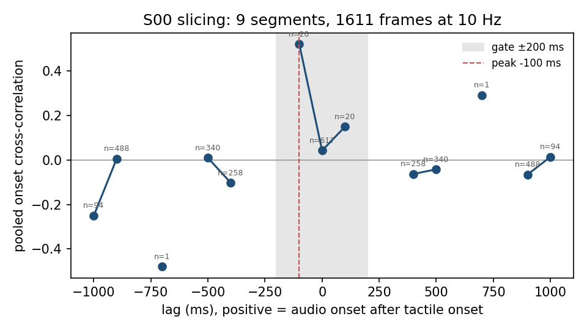

# ActionSense S00 pilot: go/no-go gate report

Date: 2026-10-29. Spec: `docs/superpowers/specs/2026-10-28-actionsense-world-design.md`,
section 7. Issue: #45. Code: `main` at `06525dd` (PRs #48, #49), nerve-wml v1.8.1,
ffmpeg 9.0.2, macM1 (Apple M1, 32 GB, macOS 27.0.1). Driver:
`scripts/pilot_actionsense.sh`; check 3 helper: `scripts/pilot_actionsense_xcorr.py`.

## Verdict

| check | result | key number |
|---|---|---|
| 1. no abort, equal lengths | PASS | 7 tensors + rows.pt, all 7165 rows |
| 2. clock agreement, monotonic | PASS (see caveat) | 0 backwards steps; labelled 0 .. 2967.8 s inside video and audio spans |
| 3. tactile/audio onset xcorr | formal PASS, **not evidential** | peak at -100 ms, but on 20 pairs; 0 ms lag (617 pairs) r = 0.04 |
| 4. extraction determinism | PASS | 8/8 `.pt` sha256 identical |
| 5. smoke cell determinism | PASS | 4/4 sha256 identical |

**Recommendation to the PI: NO-GO for Task 6 as is.** Checks 1, 2, 4 and 5 pass.
Check 3 meets the letter of the gate, but the peak rests on 20 frame pairs and
the well-sampled lags show no correlation, so it does not establish physical
sanity. The root cause is an audio-reduction artefact (42 % of the frames
dropped by the audio timestamp drift test, see "Audio drops" below), which also
thins the data for the experiment itself. Suggested next step: fix the audio
chunk timing, re-run this pilot, then decide.

## Inputs (Step 1, fetched earlier, sha256-verified)

Sizes and sha256 from `data/actionsense_raw/MANIFEST.json` (8 files,
37 487 809 070 bytes, two recordings):

| file (S00/) | bytes | sha256 |
|---|---|---|
| `2022-06-07_17-13-41_streamLog_actionNet-microphone_S00.hdf5` | 4 168 536 | `51375aaad0b767f59b71c842c9461c625615f30208803b21446bddfe49bca0cd` |
| `2022-06-07_17-13-41_streamLog_actionNet-microphone_S00_sink_chunked_data.wav` | 200 687 660 | `f33a444e2d44caf3564f55a70e77c2c69a20fe74fe65398d9ce790f53439a401` |
| `2022-06-07_17-18-46_S00_eye-tracking-video-world_frame.mp4` | 10 512 607 477 | `3920bb1c82a732ffc30462ebdfc32efba60fd3dbabdbaf517a4a5b2e7683935b` |
| `2022-06-07_17-18-46_streamLog_actionNet-wearables_S00.hdf5` | 907 171 978 | `74112cdd30d246f8f8e8b1b2ff80b858b8562ea04ef0a56f9c945697d70b6e25` |
| `2022-06-07_18-11-04_streamLog_actionNet-microphone_S00.hdf5` | 7 339 776 | `ebe3e29e131813180c8ecab8d922d73e07433f71d49486c94d1e31424625918c` |
| `2022-06-07_18-11-04_streamLog_actionNet-microphone_S00_sink_chunked_data.wav` | 351 174 700 | `a7ef42595f11f41599f3317fcc31d87b185598b55247e2650cfdca84fc1741da` |
| `2022-06-07_18-11-37_S00_eye-tracking-video-world_frame.mp4` | 21 206 630 213 | `e02ba6a1c7f81f1ce22d88e1f70cb7b4fb8b2393228455b142f8ecab07b72bcb` |
| `2022-06-07_18-11-37_streamLog_actionNet-wearables_S00.hdf5` | 4 298 028 730 | `e0d5cfcbd284977c087afbe9e8ab4332963d0bf3a2cb68776f15b28acb46d7c8` |

The first recording (`17-18-46`) has an **empty** `experiment-activities`
table (0 rows): it contributes no labelled segment, so its 10.5 GB video is
never decoded. All S00 rows come from the second recording (`18-11-37`).

## Extraction (Steps 2-3)

`extract_actionsense.py --subjects S00`, run twice under `nice -n 10`:
373 s (out_a) and 372 s (out_b) wall time. Output 64 MB in total for both
caches and the smoke runs.

Tensor shapes: audio (7165, 128), vision (7165, 16, 16), tactile (7165, 32),
gravity (7165, 3), force (7165, 6), labels (7165,), subject (7165,);
`rows.pt` time_s / segment_id / raw_label_idx (7165,) each.

### Counters (MANIFEST.md, S00)

| counter | frames | share of 13 192 |
|---|---|---|
| `frames_total` | 13 192 | 100 % |
| `drop:tactile` | 448 | 3.4 % |
| `drop:force` | 0 | 0 % |
| `drop:gravity` | 0 | 0 % |
| `drop:vision` (outside span 0, gap 0) | 0 | 0 % |
| `drop:audio` (outside span 0, gap 5579) | 5 579 | 42.3 % |
| `frames_kept` | 7 165 | 54.3 % |

Other counters: `audio_timestamp_gap` 5776 (counted before the tactile drop),
`bad` 1, `unclosed` 0, no `audio_file_inconsistent`, no
`session_vision_frame_count_mismatch`, no ffmpeg failure. Unmapped activity
pairs (dropped by design): "Get items from refrigerator/cabinets/drawers" 5,
"Open a jar of almond butter" 3, "Get items from cabinets: ..." 1,
"Stack on table: ..." 1.

### Class frequencies and majority baseline

| family | meaning | rows | share |
|---|---|---|---|
| 0 | cutting (peel, slice) | 3190 | 0.4452 |
| 1 | spreading and jars | 591 | 0.0825 |
| 2 | cleaning (wipe, clean) | 673 | 0.0939 |
| 3 | pouring and tableware | 2711 | 0.3784 |

Majority-class baseline: **0.4452**.

## Check 1: no abort, equal lengths — PASS

Both runs exited 0; `check_aligned` (#45) accepted the per-subject arrays and
the concatenated tensors plus `rows.pt`: every tensor has 7165 rows.

## Check 2: clock agreement and monotonic timestamps — PASS (caveat)

Spans relative to the first labelled segment start (MANIFEST.md, `18-11-37`):

| stream | span (s) | n | backwards steps |
|---|---|---|---|
| labelled segments | 0.0 .. 2967.8 | | |
| world video `frame_timestamp` | -290.9 .. 3532.1 | 113 495 | 0 |
| microphone `18-11-04` (sample times) | -318.4 .. 3341.9 | | 0 (file accepted) |
| microphone `17-13-41` | -3761.4 .. -1670.4 | | 0 (covers no frame) |
| myo-left / myo-right emg | -281.9 .. 3529.2 | 624 467 / 616 471 | 0 |
| myo-right acceleration_g | -281.9 .. 3529.1 | 159 626 | 0 |
| tactile left / right | -281.6 .. 3529.2 | 22 615 / 22 741 | 0 |

The labelled span lies inside the video and the audio spans, so
`drop:vision:outside_span` = `drop:audio:outside_span` = 0. Every timestamp
series is monotonic, the decoded video frame count equals the number of
`frame_timestamp` entries, and each WAV holds exactly 2048 x
`len(chunk_timestamp)` samples.

Caveat, stated for the PI: the spec wording says the media start and end
"fall inside the wearable recording". Strictly, they do not: the video starts
9.0 s and the microphone 36.5 s before the first wearable sample, and the
video ends 2.9 s after the last one. The plan's operational test (media cover
the labelled segments, timestamps monotonic) passes; the literal spec test
would fail on these margins, which only concern unlabelled time.

## Check 3: tactile vs audio onsets on slicing — formal PASS, not evidential

Method (`scripts/pilot_actionsense_xcorr.py`, on out_a): frames whose raw
label starts with "slice" (Slice a cucumber / a potato / bread): 9 segments,
1611 frames. Tactile signal `tactile.sum(1)`, audio energy = mean of the 128
z-scored log-mel bands. Onset = positive part of the first difference between
two consecutive 10 Hz frames of the same segment (a dropped frame breaks the
pair); each onset series is standardised per segment; the cross-correlation is
pooled over segments for lags -1 s .. +1 s (resolution 100 ms). Positive lag =
audio after tactile.



| lag (ms) | -1000 | -900 | -700 | -500 | -400 | -100 | 0 | +100 | +400 | +500 | +700 | +900 | +1000 |
|---|---|---|---|---|---|---|---|---|---|---|---|---|---|
| xcorr | -0.25 | 0.00 | -0.48 | 0.01 | -0.10 | **0.52** | 0.04 | 0.15 | -0.06 | -0.04 | 0.29 | -0.07 | 0.01 |
| pairs | 94 | 488 | 1 | 340 | 258 | 20 | 617 | 20 | 258 | 340 | 1 | 488 | 94 |

Lags -800, -600, -300, -200, +200, +300, +600, +800 have **zero** valid pairs.

Peak lag: **-100 ms** (value 0.52), inside the ±200 ms gate, so the scripted
test returns PASS. It is not evidence of physical alignment:

- the peak rests on 20 frame pairs; the best-sampled lag (0 ms, 617 pairs)
  gives 0.04, i.e. no onset co-occurrence;
- the pair counts follow a periodic pattern (zero at ±200, ±300 ms, many at
  0 and ±900 ms), which comes from the periodic audio drops, not from the
  activity;
- the best value outside the gate (0.29 at +700 ms) rests on a single pair.

The threshold was not changed; the numbers above are the first and only run
of this analysis on S00 (the helper was re-run only to add pair counts and the
figure annotation; the values did not change).

## Check 4: extraction determinism — PASS

`shasum -a 256` of out_a and out_b, pairwise identical:

```
c6b01c550d4d99906cb4f8413a9840a19a6ffeefc066a63258494ecdd4d7f6c2  audio.pt
834984b100329e2e2ba1e5fc561eabdb25f64eca70127c18b9b6a1abf2dfff6e  force.pt
b95dadaa6a8b385453c5395b6b4c3b27ecbea187a5176323eeb24a9f1a3a75c5  gravity.pt
16f43c149e07c5a2c4c83a5bff5818187974ddfaf4c513860837430cb95d7b65  labels.pt
cc2d9d22113c6122e06fdeedb17d974d4de8e6391d6c7bae6c28ae6d8dde0909  rows.pt
4c1ac7e5e19eef221036b4f3e243e1146b05090d22e19b5a55785044f4a626ef  subject.pt
0f810fca706ecf7a4abf96adad9acaba5b01ce02418f28aba7888fc8d2546fc9  tactile.pt
49ef285ddc83ba04686da766a6cdef75f6a237ac49cb167456649b533d6ef083  vision.pt
```

## Check 5: smoke cell on ActionSenseWorld — PASS

`BOUBA_SENS_ACTIONSENSE_DATA=out_a`; `train --world actionsense --steps 20
--batch-size 16 --seed 0`, `lesion --world actionsense --modality audio
--timing T2 --steps 20 --seed 10000`, `eval --metrics Me1,Me2`, twice in
fresh processes. The four files of `tests/unit/test_cli_determinism.py`:

| file | sha256 (run a = run b) |
|---|---|
| `phase1/model.pt` | `28e06089d0d73b10ef2c2cb26878c925f74f5bca0a37a2078274bb00758fb11b` |
| `phase2_t2/model.pt` | `9bce7c9418f5716fdf475eccdb6bd344432680e271c00ab29b7494fe12bacbc6` |
| `phase2_t2/per_query_me1.json` | `ed27c8c070c78bff622b30a3208f4bcd04fd802e24391c57b68908ebd6019544` |
| `phase2_t2/eval_report.json` | `083b0312988359c7ad31b8cf8c385373d77b1ee8c4f5c106895e1ebdeecc4712` |

Eval (20 + 20 steps, smoke only, not a result): me1 0.50, me1_probe 0.00,
me2 0.304.

## Audio drops: what the real files show

The microphone HDF5 `chunk_timestamp` is not one timestamp per 42.7 ms
chunk at a steady pace. In both S00 microphone files the step between
consecutive timestamps is ~0 ms, ~43 ms or ~85 ms (percentiles 1/5/50/95/99:
0.0001 / 0.0001 / 0.0429 / 0.085 / 0.085 s; max 0.141 s): chunks are stamped
in bursts. Over a whole file the timestamps agree with the sample count
(3660.3 s of timestamps vs 3658.1 s of samples for `18-11-04`, i.e. no real
gap of note). The extractor flags a frame as a timestamp gap when the
timestamps spanned by its 100 ms window deviate from the nominal sample
duration by more than 20 ms; with this burst pattern that test fails on about
two thirds of 2-chunk spans (0.667 at k = 2 and 5 chunks, 0.001 at k = 3), so
42 % of the frames are dropped for audio although the WAV is continuous.

A second consequence: each frame is placed in the WAV from a single, jittery
chunk timestamp, so the audio window may sit up to ~40-85 ms off its tick.
Placing samples on a fit of timestamp vs sample index (or using the WAV
start plus the sample rate, checked against the timestamps) would remove both
the drops and the jitter. This is a code change for a follow-up, not part of
this gate.

## Reproduce

On macM1, in the repository root, with the S00 raw files in place:

```
RAW=data/actionsense_raw WORK=$HOME/hypneum-lab/actionsense/pilot \
  caffeinate -is nice -n 10 ./scripts/pilot_actionsense.sh
```

Data licence of the derived tensors: CC BY-NC-SA 4.0 (ActionSense, DelPreto
et al., NeurIPS 2022). No tensor is committed; only this report and the
figure.
